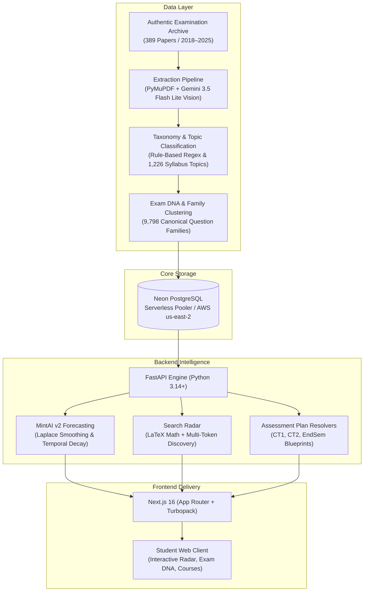

# MarkMint System Architecture

## 1. System Overview

MarkMint is a deterministic academic intelligence platform designed for students at **SRM Institute of Science and Technology (SRMIST)** under **Regulation 2021**. The architecture enforces zero synthetic hallucination: every prediction, recurrence metric, and high-yield topic recommendation is strictly grounded in verified past university examination papers.

---

## 2. Component Breakdown

### A. Ingestion & Extraction Engine
- **Corpus Stager**: Downloads, verifies, and stages authentic university papers and slide decks into `corpus/Semester_{1..8}/`.
- **Vision Extraction**: Utilizes `pymupdf` to render page bitmaps at 150 DPI and invokes `gemini-3.5-flash-lite` with structured JSON schema gating.
- **Idempotent Cache**: Caches all parsed question schemas in `data/sem*/extractions/*.json` for repeatable, offline execution.

### B. Curriculum & Taxonomy Registry
- **Curriculum Mapping**: Unidirectional resolution from 40+ engineering branches (`canonical_curriculum.json`) $\to$ semester subjects $\to$ authoritative `courses` (922 `MATCHED` mappings).
- **Taxonomies**: Covers **43 courses** across Semesters 1 through 8, each structured into 5 authoritative units, 150 topics per course cohort, and unified concept graphs.
- **Assessment Blueprints**: Standardized `CourseAssessmentPlan`, `AssessmentComponent`, and `AssessmentCoverage` modeling continuous learning assessments (CT1, CT2) and summative university examinations (EndSem).

### C. MintAI v2 Forecasting & Exam DNA
- **Recurrence Tracking**: Groups questions into canonical `QuestionFamily` clusters (`exact_repeat`, `family_repeat`, `singleton`).
- **Probabilistic Calibration**: Calculates appearance probability via Laplace smoothing:
  $$P(\text{Topic}) = \frac{k + 1}{N + 2}$$
  where $k$ is historical appearances and $N$ is total historical papers.
- **Exponential Recency Weighting**: Prioritizes modern question formats and down-weights historical drift.
- **Strict Temporal Isolation**: All predictions and backtests enforce $\text{Exam.year} < \text{target\_year}$ to prevent look-ahead contamination.

### D. Universal Question Bank & Search Radar
- **Multi-Token Query Engine**: Searches across 11,498 authentic examination questions.
- **Mathematical Formula Support**: Native LaTeX query matching for symbols, operators, and matrix environments (e.g. `$H(z)$`, `\begin{pmatrix}`, `\nabla^2`).
- **Topic Questions Viewer**: Instant inspection of authentic past questions mapped to topics with exact marks, term/year metadata, and MintAI variation generators.

---

## 3. Infrastructure & Environments

- **Database**: **Neon Serverless PostgreSQL** (PostgreSQL 18.6 on AWS `us-east-2`) with connection pooling and SSL encryption (`sslmode=require`).
- **Backend API**: **FastAPI** deployed on **Render** (Python 3.14+ runtime, Gunicorn/Uvicorn workers).
- **Frontend**: **Next.js 16** with **Turbopack** deployed on **Vercel** with edge caching, Server-Side Generation (SSG), and dynamic route rendering.
- **Testing**: **Pytest** automated backtesting suite with 100% pass rate validating cross-year prediction precision.
