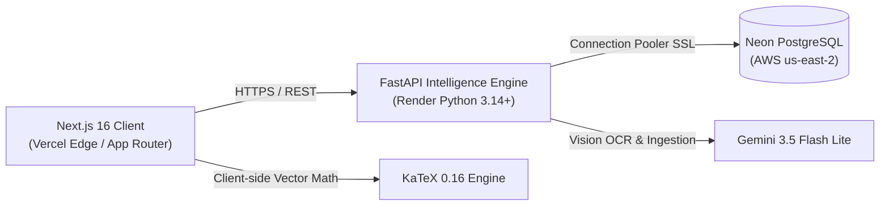

<div align="center">
  
  
  
  
  
  
</div>

<br />

<div align="center">
  <h2>🍃 MarkMint</h2>
  <p><strong>Deterministic Academic Intelligence, Exam Forecasting &amp; Interactive Testing Platform for SRMIST</strong></p>
  <p><strong>MarkMint v2.0 – Semesters 1–8 Full Curriculum &amp; Cycle Test Intelligence Release</strong></p>
  <p>
    <a href="https://markmint.vercel.app">Live Web App</a>
    ·
    <a href="https://markmint.onrender.com/docs">API Documentation</a>
    ·
    <a href="https://markmint.onrender.com/api/intelligence/corpus-health">Corpus Health</a>
    ·
    <a href="https://github.com/namanipie/markmint/issues">Report Issue</a>
  </p>
</div>

---

## 📌 Executive Summary

**MarkMint** is a deterministic academic intelligence platform built for students at **SRM Institute of Science and Technology (SRMIST)** under **Regulation 2021**. The platform ingests authentic past university examination papers (End Semester, Model, CT1, and CT2), digitizes and purifies questions into authoritative syllabus topics, isolates Multiple Choice Questions (MCQs) into an interactive testing engine, and calculates calibrated, evidence-backed exam forecasts.

Every prediction, question frequency metric, and practice worksheet is strictly grounded in verified historical examination records with verified faculty answer keys and zero synthetic hallucination.

---

## 📊 Live Corpus Metrics & Verification

All statistics reflect the verified production database on **Neon Serverless PostgreSQL** and the academic intelligence corpus:

| Metric | Production Count | Description |
| :--- | :---: | :--- |
| **Total Database Questions** | **16,268** | Digitized, classified, and verified across all historical examination papers |
| **Cycle Test Archive Questions** | **5,536** | Formative assessment questions (CT1, CT2, CT3, Model) with faculty solutions |
| **Interactive MCQs** | **8,942** | 100% mapped into curriculum topics with structured options and explanations |
| **Engineering Courses** | **43** | Comprehensive 4-year curriculum across Semesters 1 through 8 |
| **Authentic Exam Papers** | **389+** | Historical university and cycle examinations from 2018 to 2025 |
| **Question Families** | **9,798** | Semantic clusters tracking exact and canonical recurrence |
| **Syllabus Topics** | **1,226** | Authoritative 5-unit curriculum topics across 255 units |
| **Concepts** | **1,036** | Core engineering and mathematical theoretical concepts |
| **Curriculum Mappings** | **922** | Verified course links across 40+ engineering branch curricula |
| **Study Evidences** | **4,962** | Slide deck lecture notes and unit study references |

---

## 🚀 Core Features

### 1. 🔍 Universal Question Bank & LaTeX Search Radar
- **Multi-Token Search Engine**: Search across 16,268 authentic examination questions with debounced instant filtering.
- **LaTeX Mathematical Formula Support**: Query directly with mathematical notation (e.g. `$H(z)$`, `\begin{pmatrix}`, `\nabla^2`, `Fourier`, `DFT`).
- **Authentic Question Viewer**: Inspect past questions mapped to topics with mark allocations, term/year metadata, and repeat classifications (`exact_repeat`, `family_repeat`, `singleton`).

### 2. ⚡ Authentic Cycle Test Archive & Printable Worksheets
- **Universal Assessment Evidence**: 5,536 authentic questions extracted directly from SRM past Cycle Test papers (CT1, CT2, CT3, Model) across all 43 catalog courses.
- **Marks Weightage Filter**: Filter questions by weightage: `1 Mark (MCQ)`, `2 Marks (Short Answer)`, `4–8 Marks (Medium Answer)`, or `10–15 Marks (Comprehensive)`.
- **One-Click Faculty Solutions**: Instant `Expand All` / `Collapse All` toggle to inspect faculty marking keys and step-by-step solutions.
- **Printable Practice Worksheet View**: Fullscreen printable worksheet formatted with SRMIST letterhead, official examination instructions, formatted KaTeX math, toggleable solution keys, and instant `window.print()` / PDF export.

### 3. 🎯 Interactive MCQ Testing Engine
- **Practice Drill Mode**: Immediate visual feedback, color-coded correct/incorrect indicators, and faculty explanations upon option selection.
- **Timed Examination Quiz Mode**: Real-time timer countdown, swipeable question navigator strip, status badges (*Answered*, *Unanswered*, *Marked for Review*), and comprehensive end-of-test performance scorecards.
- **Strict Separation**: 100% of multiple choice questions are isolated from descriptive questions, ensuring zero option leaks in normal question sections.

### 4. 📐 Universal KaTeX Mathematical Formula Engine
- **Dual-Path Math Engine**:
  - **Pure Formula Fast Path**: Instantly renders standalone equations, options, roots, and complex numbers (e.g. $(D^2 - 4)y = 0$, $\pm 2$, $1 \pm 2i$, $\pm \sqrt{2}$, $\pm i\sqrt{3}$, $y = Ae^{2x} + Be^{-2x}$).
  - **Tokenized Path**: Accurately extracts and renders mixed differential equations, integrals ($\int_0^1 x^2 dx$), operators, and Greek trigonometric terms without capturing trailing English words.
- **Universal Component Coverage**: KaTeX math rendering is integrated into the Question Bank, Cycle Test Drawers, Topic Detail Views, and Question Cards.

### 5. 🧠 MintAI v2 Forecasting Engine
- **Laplace-Smoothed Calibration**: Computes rigorous appearance probabilities:
  $$P(\text{Topic}) = \frac{k + 1}{N + 2}$$
- **Recency Decay Weighting**: Prioritizes modern question papers while preserving longitudinal patterns.
- **Strict Temporal Isolation**: Evaluates models only against historical data chronologically prior to target examination years ($\text{Exam.year} < \text{target\_year}$).

### 6. 📱 Mobile-First Responsive Design (375px–390px Viewports)
- **Collapsible Curriculum Filter Accordion**: Replaces tall desktop sidebars on mobile screens with a compact selector card (`Change Subject` / `Hide Selectors`), eliminating 500px+ of vertical scrolling.
- **Touch-Friendly Controls**: Enforces `min-h-[44px]` touch targets (`touch-manipulation`) across drawer tabs, category switchers, and option buttons.
- **Swipeable Navigation**: Horizontal scrolling strips for quiz questions and section filters.

### 7. 🧬 Exam DNA Behavioral Profiling
- **Recurrence Tracking**: Clustered into exact repeats, conceptual variants, and singleton questions.
- **Section & Mark Distribution**: Tracks the proportion of marks allocated to Part A, Part B, and Part C across assessment cycles.
- **Assessment Blueprints**: Distinguishes formative Continuous Learning Assessments (**CT1**, **CT2**) from summative University **End Semester** examinations.

### 8. 📚 4-Year Course Directory & Curriculum Taxonomy
- Full 5-unit syllabi for **43 foundational and advanced courses**:
  - **Semester 1 & 2**: Calculus, Physics, Chemistry, Basic Electrical, Basic Mechanical, C/Python Programming, Biology, Foreign Languages (6 tracks: German, French, Japanese, Korean, Spanish, Mandarin).
  - **Semester 3 & 4**: Transforms & Boundary Value Problems, Probability & Queueing Theory, Data Structures & Algorithms, Object-Oriented Design, Operating Systems, Database Management Systems.
  - **Semester 5 & 6**: Discrete Mathematics, Formal Languages & Automata, Computer Networks, Software Engineering, Compiler Design, Data Science.
  - **Semester 7 & 8**: Internet of Things, Digital Image Processing, Security Governance Risk & Compliance, Security Risk Management & Principles, Information Security, Digital Signal Processing.

---

## 🛠️ Architecture & Tech Stack



- **Frontend**: Next.js 16 (App Router), React 19, Tailwind CSS v4, KaTeX, Framer Motion, Lucide Icons.
- **Backend API**: FastAPI, SQLAlchemy 2.0, Pydantic v2, Python 3.14+.
- **Database**: Neon Serverless PostgreSQL (PostgreSQL 18.6 on AWS `us-east-2`).
- **Mathematical Rendering**: KaTeX with dual-path tokenization and auto-balancing sanitization.
- **Ingestion & Extraction**: PyMuPDF (`pymupdf`), Gemini 3.5 Flash Lite Vision OCR, regex taxonomies.
- **Deployment**: Vercel (Frontend), Render (Backend), Neon (Database).

---

## 💻 Local Development

### 1. Prerequisites
- Python 3.11+ or 3.14
- Node.js 20+ and npm

### 2. Backend Setup
```bash
# Clone repository
git clone https://github.com/namanipie/markmint.git
cd markmint

# Create virtual environment
python -m venv .venv
# Windows: .\.venv\Scripts\activate
# Unix: source .venv/bin/activate

# Install Python dependencies
pip install -r requirements.txt

# Run FastAPI backend server
uvicorn backend.main:app --reload --port 8000
```

### 3. Frontend Setup
```bash
# Install Node dependencies
npm install

# Run Next.js development server
npm run dev

# Or run optimized production build
npm run build
npm run start
```

Navigate to `http://localhost:3000` to view the application.

### 4. Running Automated Tests & Visual Verifications
```bash
# Run backend prediction backtesting tests
pytest backend/tests/test_prediction_backtesting.py -v

# Run full backend test suite
pytest backend/tests/ -v

# Run Playwright visual verifications (Math, MCQ Isolation, Mobile UI)
python scripts/testing/capture_calculus_ct2.py
python scripts/testing/verify_question_bank_upgrades.py
```

---

## 🌐 Production Health & Observability

- **Frontend**: [https://markmint.vercel.app](https://markmint.vercel.app)
- **Backend API**: [https://markmint.onrender.com](https://markmint.onrender.com)
- **Swagger Docs**: [https://markmint.onrender.com/docs](https://markmint.onrender.com/docs)
- **Database Status**: [https://markmint.vercel.app/api/neon/health](https://markmint.vercel.app/api/neon/health)
- **Corpus Intelligence**: [https://markmint.onrender.com/api/intelligence/corpus-health](https://markmint.onrender.com/api/intelligence/corpus-health)

---

## 👥 Contributors

- **Aditya Kajala** ([@adityakajala1](https://github.com/adityakajala1)) – Frontend Architecture, Interface & Motion
- **Naman Kumar** ([@namanipie](https://github.com/namanipie)) – Backend Systems, Predictive Modeling & Intelligence Pipeline

---

## 📄 License

This project is licensed under the MIT License. See [LICENSE](LICENSE) for details.
