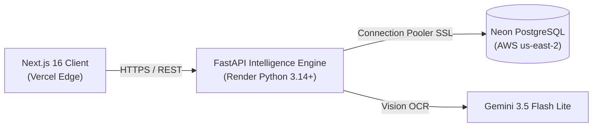

<div align="center">
  
  
  
  
  
</div>

<br />

<div align="center">
  <h2>🍃 MarkMint</h2>
  <p><strong>Deterministic Academic Intelligence & Exam Forecasting Platform for SRMIST</strong></p>
  <p><strong>MarkMint v2.0 – Semesters 1–8 Full Curriculum Release</strong></p>
  <p>
    <a href="https://markmint.vercel.app">Live Web App</a>
    ·
    <a href="https://markmint.onrender.com/docs">API Documentation</a>
    ·
    <a href="https://markmint.onrender.com/api/intelligence/corpus-health">Corpus Health</a>
    ·
    <a href="https://github.com/namanipie/markmint/issues">Report Issue</a>
  </p>
</div>

---

## 📌 Executive Summary

**MarkMint** is a deterministic academic intelligence platform built for students at **SRM Institute of Science and Technology (SRMIST)** under **Regulation 2021**. The platform ingests authentic past university examination papers, categorizes questions into authoritative syllabus topics, clusters recurring question families, and calculates calibrated, evidence-backed exam forecasts.

Every prediction, question frequency metric, and high-yield recommendation is strictly grounded in verified university examination records with zero synthetic hallucination.

---

## 📊 Live Corpus Metrics & Verification

All statistics reflect the live production corpus verified on **Neon PostgreSQL** and **Render**:

| Metric | Production Count | Description |
| :--- | :---: | :--- |
| **Engineering Courses** | **43** | Comprehensive 4-year curriculum across Semesters 1 through 8 |
| **Authentic Exam Papers** | **389** | University examinations from 2018 to 2025 |
| **Verified Questions** | **11,498** | Digitized, classified, and mapped to syllabus topics |
| **Question Families** | **9,798** | Semantic clusters tracking exact and canonical recurrence |
| **Syllabus Topics** | **1,226** | Authoritative 5-unit curriculum topics across 255 units |
| **Concepts** | **1,036** | Core engineering and mathematical theoretical concepts |
| **Curriculum Mappings** | **922** | Verified course links across 40+ engineering branch curricula |
| **Study Evidences** | **4,962** | Slide deck lecture notes and unit study references |

---

## 🚀 Core Features

### 1. 🔍 Universal Question Bank & LaTeX Search Radar
- **Multi-Token Search Engine**: Search across 11,498 authentic examination questions with instant debounce filtering.
- **LaTeX Mathematical Formula Support**: Query directly with mathematical notation (e.g. `$H(z)$`, `\begin{pmatrix}`, `\nabla^2`, `Fourier`, `DFT`).
- **Authentic Question Viewer**: Inspect exact past questions mapped to topics with mark allocations, term/year metadata, and repeat classifications (`exact_repeat`, `family_repeat`, `singleton`).

### 2. 🧠 MintAI v2 Forecasting Engine
- **Laplace-Smoothed Calibration**: Computes rigorous appearance probabilities:
  $$P(\text{Topic}) = \frac{k + 1}{N + 2}$$
- **Recency Decay Weighting**: Prioritizes modern question papers while preserving longitudinal patterns.
- **Strict Temporal Isolation**: Evaluates models only against historical data chronologically prior to target examination years ($\text{Exam.year} < \text{target\_year}$).

### 3. 🧬 Exam DNA Behavioral Profiling
- **Recurrence Tracking**: Clustered into exact repeats, conceptual variants, and singleton questions.
- **Section & Mark Distribution**: Tracks the proportion of marks allocated to Part A, Part B, and Part C across assessment cycles.
- **Continuous Assessment Blueprints**: Distinguishes formative Continuous Learning Assessments (**CT1**, **CT2**) from summative University **End Semester** examinations.

### 4. 📚 4-Year Course Directory & Curriculum Taxonomy
- Full 5-unit syllabi for **43 foundational and advanced courses**:
  - **Semester 1 & 2**: Calculus, Physics, Chemistry, Basic Electrical, Basic Mechanical, C/Python Programming, Biology, Foreign Languages (6 tracks).
  - **Semester 3 & 4**: Transforms & Boundary Value Problems, Probability & Queueing Theory, Data Structures & Algorithms, Object-Oriented Design, Operating Systems, Database Management Systems.
  - **Semester 5 & 6**: Discrete Mathematics, Formal Languages & Automata, Computer Networks, Software Engineering, Compiler Design, Data Science.
  - **Semester 7 & 8**: Internet of Things, Digital Image Processing, Security Governance Risk & Compliance, Security Risk Management & Principles, Information Security, Digital Signal Processing.

---

## 🛠️ Architecture & Tech Stack



- **Frontend**: Next.js 16 (App Router), React 19, Tailwind CSS v4, Lucide Icons, KaTeX, Framer Motion.
- **Backend API**: FastAPI, SQLAlchemy 2.0, Pydantic v2, Python 3.14+.
- **Database**: Neon Serverless PostgreSQL (PostgreSQL 18.6 on AWS `us-east-2`).
- **Extraction**: PyMuPDF (`pymupdf`), Gemini 3.5 Flash Lite Vision OCR, regex rule taxonomies.
- **Deployment**: Vercel (Frontend), Render (Backend), Neon (Database).

---

## 💻 Local Development

### 1. Prerequisites
- Python 3.11+ or 3.14
- Node.js 20+ and npm

### 2. Backend Setup
```bash
# Clone repository
git clone https://github.com/namanipie/markmint.git
cd markmint

# Create virtual environment
python -m venv .venv
# Windows: .\.venv\Scripts\activate
# Unix: source .venv/bin/activate

# Install Python dependencies
pip install -r requirements.txt

# Run FastAPI backend server
uvicorn backend.main:app --reload --port 8000
```

### 3. Frontend Setup
```bash
# Install Node dependencies
npm install

# Run Next.js development server
npm run dev
```

Navigate to `http://localhost:3000` to view the application.

### 4. Running Automated Tests
```bash
# Run backend backtesting & regression tests
pytest backend/tests/test_prediction_backtesting.py -v

# Run full test suite
pytest backend/tests/ -v
```

---

## 🌐 Production Health & Observability

- **Frontend**: [https://markmint.vercel.app](https://markmint.vercel.app)
- **Backend API**: [https://markmint.onrender.com](https://markmint.onrender.com)
- **Swagger Docs**: [https://markmint.onrender.com/docs](https://markmint.onrender.com/docs)
- **Database Status**: [https://markmint.vercel.app/api/neon/health](https://markmint.vercel.app/api/neon/health)
- **Corpus Intelligence**: [https://markmint.onrender.com/api/intelligence/corpus-health](https://markmint.onrender.com/api/intelligence/corpus-health)

---

## 👥 Contributors

- **Aditya Kajala** ([@adityakajala1](https://github.com/adityakajala1)) – Frontend Architecture, Interface & Motion
- **Naman Kumar** ([@namanipie](https://github.com/namanipie)) – Backend Systems, Predictive Modeling & Intelligence Pipeline

---

## 📄 License

This project is licensed under the MIT License. See [LICENSE](LICENSE) for details.
